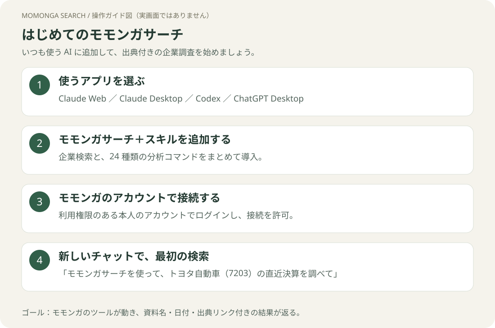

# モモンガサーチ 接続・利用ガイド

企業・開示資料・ニュースを、いつもの AI から出典付きで調べられます。
**はじめての方は、使うアプリのリンクから進んでください。認証と最初の検索まで案内します。**

| 使うアプリ | 接続ガイド |
|---|---|
| ブラウザの Claude | [Claude Web](claude-web.md) |
| PC の Claude アプリ | [Claude Desktop](claude-desktop.md) |
| Codex | [Codex](codex.md) |
| ChatGPT | [ChatGPT（デスクトップ／Web）](chatgpt.md) |

[24種のコマンド一覧と依頼例](commands.md) · [認証の共通手順](authentication.md) · [トラブルシューティング](troubleshooting.md)

## 用意するもの

- 利用する AI アプリのアカウント。組織で利用する場合は、プラグインを利用できる権限も必要です。
- **モモンガサーチの利用権限があるアカウント**。ログインするだけで契約・利用権限が付与されるわけではありません。未登録・利用申請中の場合はモモンガの担当者または社内管理者に確認してください。
- Codex の導入では、PC 上で Codex CLI と Git を使います。手順の依頼文を貼れば、Codex に設定を依頼できます。

## どちらを入れる？

| プラグイン | できること |
|---|---|
| **モモンガサーチ＋スキル** `momonga-search-skills` | 企業検索＋24種の分析コマンド。このガイドはこちらを使います。 |
| モモンガサーチ `momonga-search` | 自然な言葉で企業・資料・ニュースを検索。24種の分析コマンドは含みません。 |

**どちらか一方をインストールします。** スキル付き版には通常版の検索機能も入っています。

## このガイドについて

2026年10月21日、プラグイン 0.1.3 を基準に作成。Claude Desktop の画像は実際の画面です。操作ガイド図は手順を整理した図で、実画面の再現ではありません。ボタン名や配置はアプリの言語・バージョン・組織設定によって変わります。

設定確認の範囲と公式情報は[確認資料](sources.md)にまとめています。
