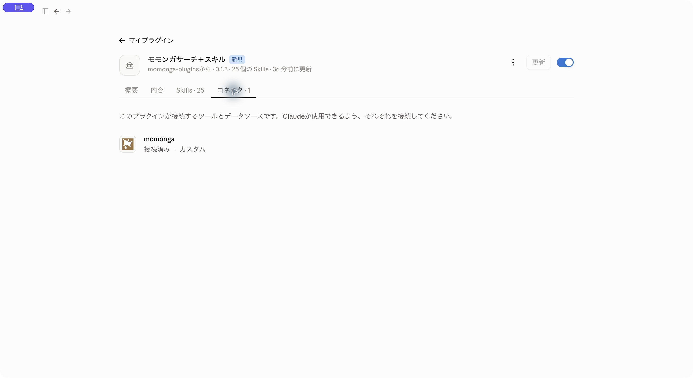

# モモンガへのログイン

[使い方のトップ](README.md)

管理者による配布は、社員のモモンガ認証を代行するものではありません。各自の利用アカウントで接続してください。

プラグインを入れたら、**「接続／Connect」**を押してモモンガにログインします。ClaudeやChatGPTへのログインとは別です。

Claudeでは **「カスタマイズ」→「プラグイン」→追加したプラグイン →「コネクタ」→「momonga」**から開きます。
ChatGPT・Codexでは、入れたプラグインの接続設定を開いてください。

ブラウザに `auth.momongasearch.com` のログイン画面が開きます。利用アカウントでログインし、接続先と権限を確認して許可します。
すでにログイン・許可済みなら、そのままアプリに戻る場合もあります。



アプリに戻ったら、新しいチャットで次を送ってみてください。

```text
モモンガサーチを使って、トヨタ自動車（7203）の直近決算を出典付きで調べて。
```

接続済みでも「利用権限がない」と出る場合は、ログインしたアカウントを確認し、モモンガの担当者へお問い合わせください。

[トラブルシューティング](troubleshooting.md)
