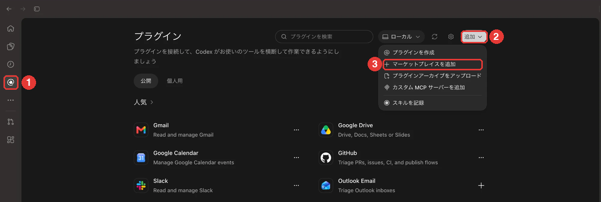
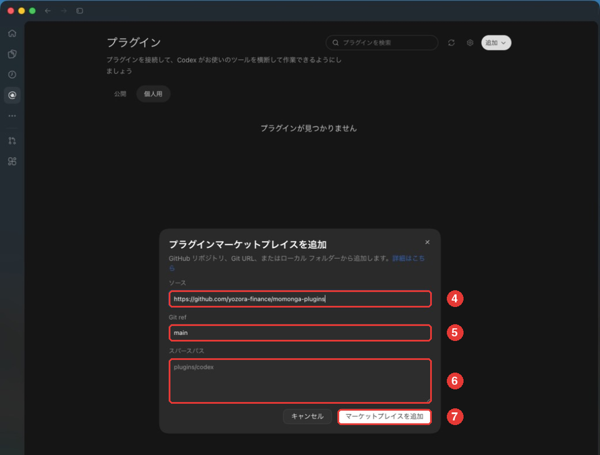
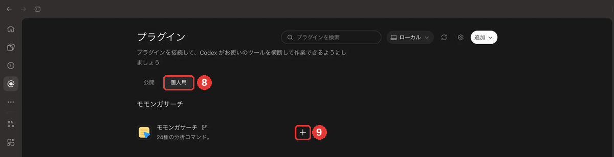

# ChatGPT・Codexでの導入手順

[トップ](../README.md)

このプラグインは、ChatGPTまたはCodexのデスクトップアプリで利用できます。ChatGPTのWeb版には対応していません。

## 手順が分かれる箇所

ChatGPTの設定は、個人のアカウントと会社のワークスペース（Business、Enterpriseなどのプラン）で別々です。左の列の「プラグイン」を開き、ワークスペース名の一覧がある場合は、会社のワークスペースをお使いです。

分かれるのは、プラグインの追加（手順1）です。モモンガサーチへのログイン（手順2）以降は、どちらの場合も同じです。

| お使いの側 | 手順1 プラグインの追加 |
|---|---|
| 会社のワークスペース | 管理者が配布したものをインストール |
| 個人のアカウント | ご自身でマーケットプレイスを追加 |

## 1. プラグインを追加する

左の列の「プラグイン」を開きます（画像の①）。画面は2026年10月時点のものです。

### 会社のワークスペースの場合

管理者がプラグインを配布している前提の手順です。ワークスペース名の一覧にある「モモンガサーチ」の詳細を開き、「＋」を押してインストールします。続けてモモンガサーチのログインが始まるので、そのまま手順2に進んでください。管理者の設定でインストール済みの場合は、手順2の「ログイン画面が開かない場合」をご覧ください。

一覧にない場合は、まだ配布されていない可能性があります。社内の管理者の方にご確認ください。
管理者の方は、[管理者の初回設定](administrators.md#chatgptcodex)の「ChatGPT・Codex」の手順をご覧ください。

### 個人のアカウントの場合

自分でマーケットプレイスを追加します。

1. 右上の「追加」→「マーケットプレイスを追加」を押します（②・③）。

   

2. 「ソース」に `https://github.com/yozora-finance/momonga-plugins`（④）、「Git ref」に `main`（⑤）を入力します。「スパースパス」は空欄のまま（⑥）、「マーケットプレイスを追加」を押します（⑦）。

   

3. 「個人用」のタブ（⑧）に追加されたマーケットプレイスが開きます。「モモンガサーチ」の行の「＋」を押してインストールします（⑨）。続けてモモンガサーチのログインが始まるので、そのまま手順2に進んでください。

   

## 2. モモンガサーチにログインする

「＋」でインストールすると、ChatGPTへのログインとは別に、モモンガサーチのログインが続けて始まります。

ブラウザに `auth.momongasearch.com` のログイン画面が開きます。招待されたメールアドレスのGoogleアカウントでログインし、接続を許可してアプリに戻ります。すでに許可済みの場合は、ログイン画面を経ずにそのままアプリへ戻ることがあります。

### ログイン画面が開かない場合

インストール済みだった場合などは、アプリの「設定」→「プラグイン」を開き、「MCP」タブの「プラグインから」にある `momonga` で認証します。`momonga` が表示されない場合は、アプリを再起動して開き直します。

## 3. 動作を確かめる

新しいチャットで `@` を入力してモモンガサーチのプラグインを選び、次のメッセージを送信します。

```text
トヨタ自動車（7203）の直近決算を出典付きで調べて。
```

ツールの使用確認が表示されたら、内容を確認して許可します。出典付きの回答が返ってくれば導入は完了です。

分析コマンドを使う際は、入力欄に `@` を入力して `ファクトシート` などを選び、会社名や条件を続けて入力します。

[コマンド一覧](commands.md) ／ [困ったとき](troubleshooting.md)
