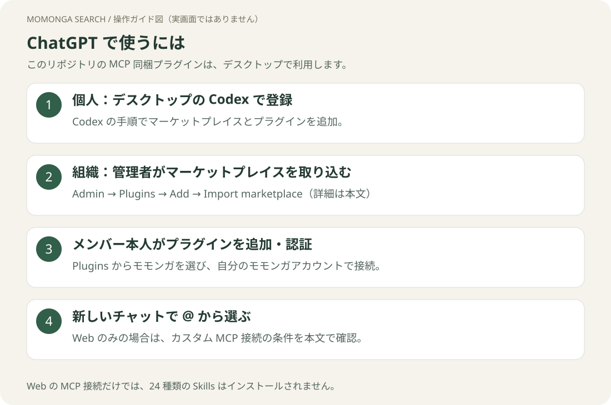
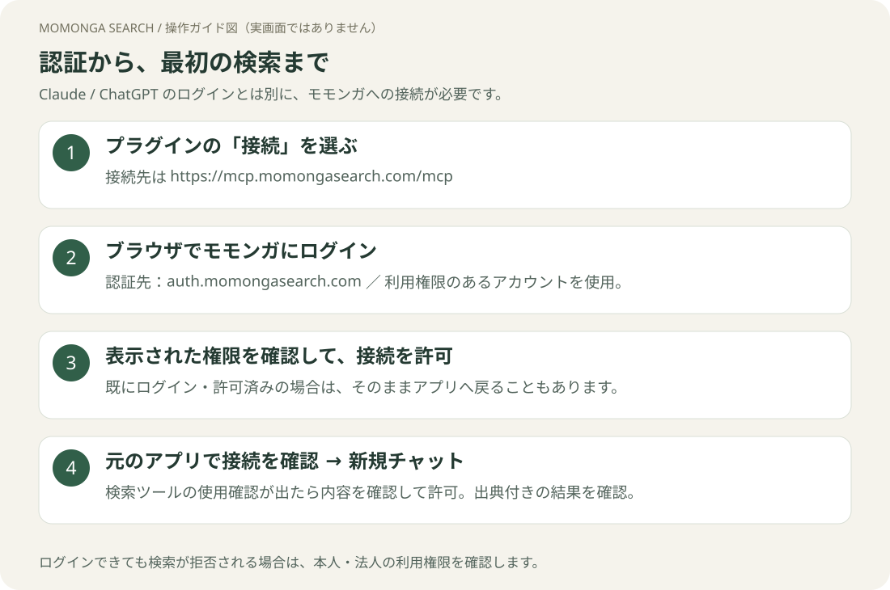

# ChatGPT で接続する

[ガイドのトップ](README.md)



## はじめに：使う環境を選ぶ

| 環境 | このリポジトリの使い方 |
|---|---|
| 個人のデスクトップ環境 | [Codex の手順](codex.md)で登録し、対応する Plugins Directory から使います。 |
| 組織で配布されたプラグイン | 下の手順で管理者が取り込み、メンバーはデスクトップで追加・認証します。 |
| Web のみ | カスタム MCP を作れる環境では検索接続を設定できます。ただし Skills は入りません。 |

**GitHubに公開されていることと、ChatGPTの公開ディレクトリに掲載されていることは別です。**
本リポジトリは MCP 設定を同梱しているため、ワークスペースへの GitHub 取り込みでは **Desktop only** になります。[OpenAI公式の取り込み仕様](https://learn.chatgpt.com/docs/enterprise/plugin-management)

## 1. デスクトップにプラグインを追加する

個人で設定する方は [Codex に貼り付ける依頼文](codex.md#1-codex-に導入を頼む)を使い、同じ PC の環境でマーケットプレイスを登録します。
登録後、Plugins Directory に **Momonga by Yozora Finance** が表示されることを確認し、**モモンガサーチ＋スキル**を選びます。既にインストール済みなら追加は不要です。

一覧が見えない場合はアプリを再起動し、登録した PC・アカウント・環境を確認します。ローカルの登録が別の PC や Web の一覧に自動で反映されるとは限りません。

### 組織の管理者が配布する場合

**Admin → Plugins → Add → Import marketplace**で次を入力します。

| 欄 | 入力値 |
|---|---|
| Source | `https://github.com/yozora-finance/momonga-plugins` |
| Path | 空欄（リポジトリのルート） |
| Branch, tag, or commit | `main` |

GitHub のアクセスを認証し、インポート結果を確認します。
取り込まれた **モモンガサーチ＋スキル**を対象メンバーが利用できる設定にします。
その後、メンバー本人がデスクトップの **Plugins → 組織名**から追加します。
取り込みによってメンバーのモモンガ認証まで完了するわけではありません。

## 2. 本人のモモンガアカウントを接続する

プラグイン詳細から **Connect／接続**を選びます。
ブラウザでモモンガにログインし、要求された権限を確認して許可したら、ChatGPT に戻ります。



[認証の共通手順](authentication.md)を参照し、接続完了を確認してください。

## 3. 新しいチャットで検索する

対応するデスクトップの Chat / Work / Codex で新しいチャットを開き、**`@`** からモモンガを選びます。

```text
モモンガサーチを使って、トヨタ自動車（7203）の直近決算を出典付きで調べて。
```

モモンガのツールが使われ、出典付きの結果が返れば利用開始できます。
分析する場合は同じ選択メニューから `factsheet` などを選び、企業名を続けてください。

## Web のカスタム MCP 接続を使う場合

この方法は**検索の接続のみ**です。24種の分析 Skills を使いたい場合は、上のデスクトップ手順を使います。
カスタム MCP の作成可否はプラン・管理者設定によって異なります。作成機能がない環境では管理者に確認してください。

1. [ChatGPT Plugins](https://chatgpt.com/plugins) を開き、**＋ → Add custom MCP server** を選びます。項目がない場合はワークスペースの利用権限を管理者に確認します。
2. 名前を「モモンガサーチ」、説明を「企業・開示資料・ニュースの検索」にします。**Connection** に下記の MCP URL を設定し、認証方法に **OAuth** を選びます。
3. OAuth の詳細設定に下記の公開 client ID を入力します。secret は空欄です。
4. 警告の内容を確認し、**I understand and want to continue → Create as a plugin** を選びます。接続に必要なモモンガへのログインと許可を完了し、取得されたツール一覧を確認します。
5. 作成されたプラグインをインストールし、新しいチャットで **@** から選んで上の検索例を送ります。

| 設定 | 値 |
|---|---|
| MCP URL | `https://mcp.momongasearch.com/mcp` |
| OAuth client ID | `pwPehWbWGeAMiRSKeMvVupqsmUZuwVxt` |
| Client secret | 空欄（公開クライアント、PKCE） |
| Scope（入力欄がある場合） | `openid offline_access momonga:read` |

登録済みの戻り先は `https://chatgpt.com/connector_platform_oauth_redirect` です。
secret が必須になる、戻り先が一致しない等の場合は、値を推測して進めず管理者に確認します。

[OpenAI公式：カスタムMCPの追加手順](https://developers.openai.com/plugins/deploy/connect-chatgpt)

## 更新する

個人のローカル環境は [Codex の更新手順](codex.md#更新する)を使います。
組織配布は管理者が **Admin → Plugins → Marketplaces → Sync now**で同期します。
更新後は新しいチャットを開いてください。

[コマンド一覧](commands.md) · [困ったとき](troubleshooting.md)
