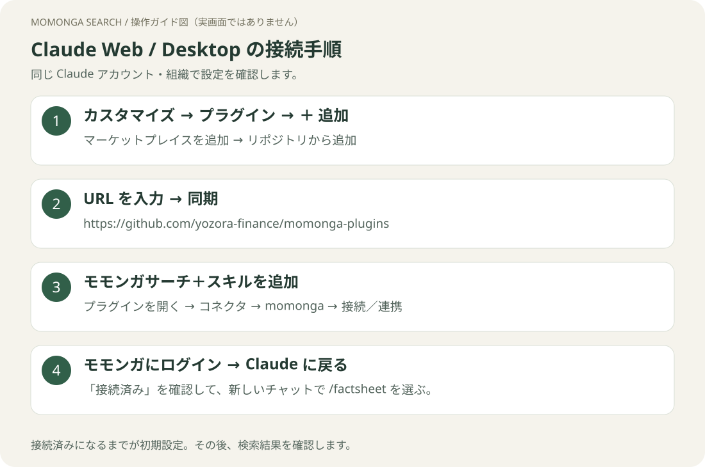

# Claude Desktop で接続する

[ガイドのトップ](README.md) · [Web の手順](claude-web.md)



## 1. Claude アプリでカスタマイズを開く

Claude Desktop にログインし、サイドバーの **カスタマイズ → プラグイン**を開きます。
Web で導入済みなら、まず **同じ Claude アカウント・組織**を選んでいることを確認してください。


## 2. プラグインを追加する

まだ一覧にない場合は、**＋ 追加 → マーケットプレイスを追加 → リポジトリから追加**を開き、次の URL を入力して同期します。

```text
https://github.com/yozora-finance/momonga-plugins
```


**モモンガサーチ＋スキル**を追加します。画像付きの細かな操作は [Web の手順 2・3](claude-web.md#2-リポジトリを登録する)と共通です。

## 3. 認証を完了する

プラグインを開き、**コネクタ → momonga → 接続／連携**を選びます。
ブラウザが開いたら、モモンガのアカウントでログインして接続を許可し、Claude アプリに戻ります。


**接続済み**なら次へ進みます。Web で接続済みの場合も、Desktop 側の状態を確認してください。反映されなければアプリを終了して起動し直します。

認証画面で迷ったら[認証の共通手順](authentication.md)を参照してください。

## 4. 新しいチャットで試す

```text
モモンガサーチを使って、トヨタ自動車（7203）の直近決算を出典付きで調べて。
```

ツール使用の確認に応答し、モモンガのツールによる出典付きの結果が返ることを確認します。
続けて新しいチャットで `/` から `factsheet` を選び、企業名を入力すれば分析コマンドも試せます。

この導入方法では、ローカルの設定ファイルを編集する必要はありません。

[コマンド一覧](commands.md) · [更新する](claude-web.md#更新する) · [トラブルシューティング](troubleshooting.md)
