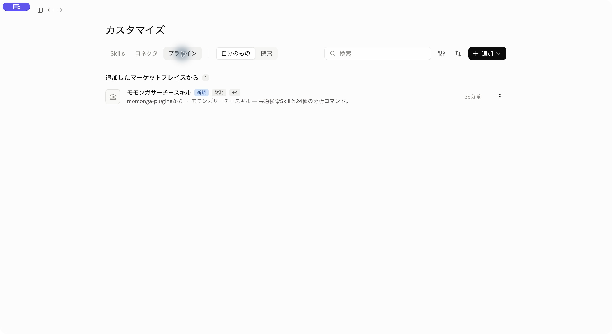
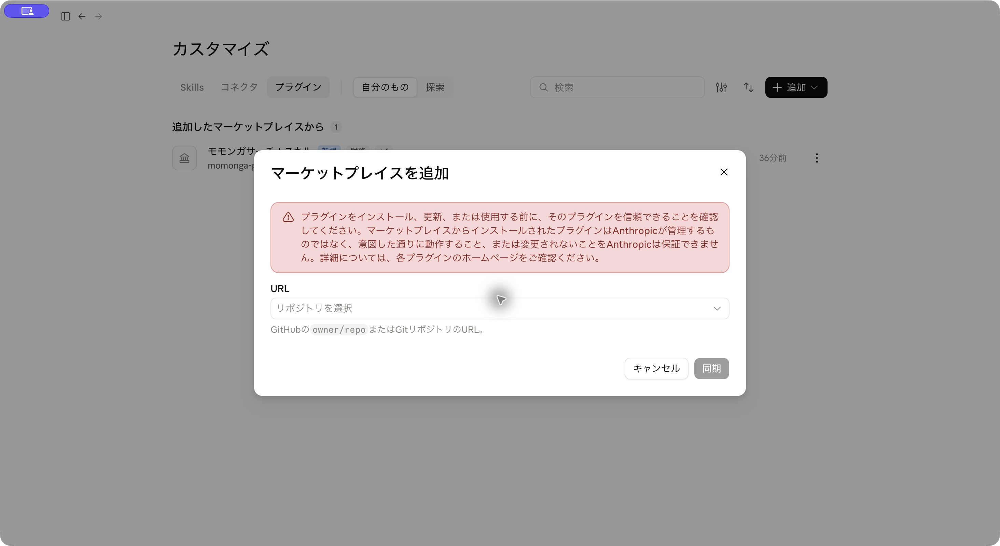

# Claudeの接続手順（Web・Desktop）

[使い方のトップ](README.md)

Claudeアカウントと、自分のモモンガ利用アカウントを用意してください。個人でも会社でも、公開マーケットプレイスの追加操作は同じです。会社で使う場合は組織の利用制限を確認してください。管理者向けの説明は[初回設定](administrators.md)にあります。

## 1. プラグインを入れる

公開マーケットプレイスを自分のClaudeアカウントに追加します。すでに「モモンガサーチ＋スキル」を追加済みの方は、「2. モモンガにログインする」へ進んでください。

[Claude Web](https://claude.ai/) またはClaudeアプリを開き、**「カスタマイズ」→「プラグイン」**を押します。



右上の **「＋追加」→「マーケットプレイスを追加」→「リポジトリから追加」**を選びます。

URL欄に次を入れ、**「同期」**を押します。

```text
https://github.com/yozora-finance/momonga-plugins
```



一覧に出てきた **「モモンガサーチ＋スキル」**を追加します。

※画像はClaude Desktopです。Webも同じ手順です。すでに片方で追加した方は、同じClaudeアカウント・組織でプラグインが表示されるか確認してください。表示されていれば、もう一度追加する必要はありません。

## 2. モモンガにログインする

追加したプラグインを開き、**「コネクタ」→「momonga」→「接続／連携」**を押します。

ブラウザに認証画面が開いたら、モモンガのアカウントでログインします。許可を求められたら内容を確認して進んでください。ログイン済みの場合は、そのままClaudeに戻ることもあります。

下のように **「接続済み」**と出れば設定は終わりです。表示が変わらない場合は、Webは再読み込み、Desktopは終了して起動し直してください。


## 3. 使ってみる

新しいチャットを開き、次を送ってください。

```text
モモンガサーチを使って、トヨタ自動車（7203）の直近決算を出典付きで調べて。
```

ツールの使用を確認されたら、内容を見て許可します。モモンガで検索が行われ、資料の出典が付いた回答が返ってきます。

コマンドを使うときは、入力欄に `/` を打ち、候補から `factsheet` などを選びます。その後ろに会社名を続けます。

```text
/factsheet トヨタ自動車（7203）
```

[ほかのコマンドを見る](commands.md) ／ [うまくいかないとき](troubleshooting.md)

## 更新する

「プラグイン」の **「＋追加」→「マーケットプレイスを管理」**から更新を確認します。プラグインに「更新」が表示されたら押し、新しいチャットを開いてください。
