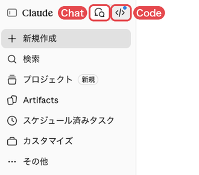
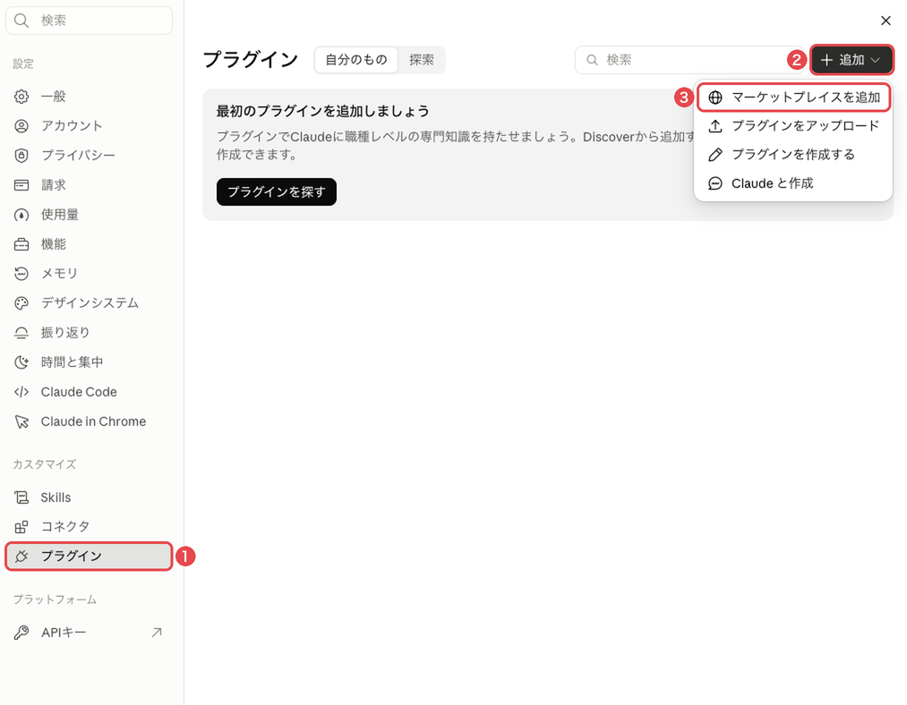
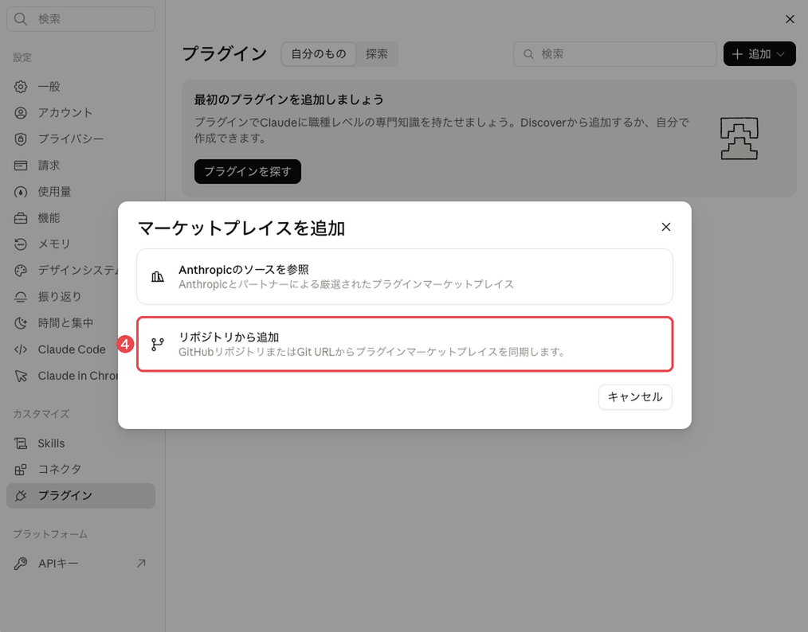
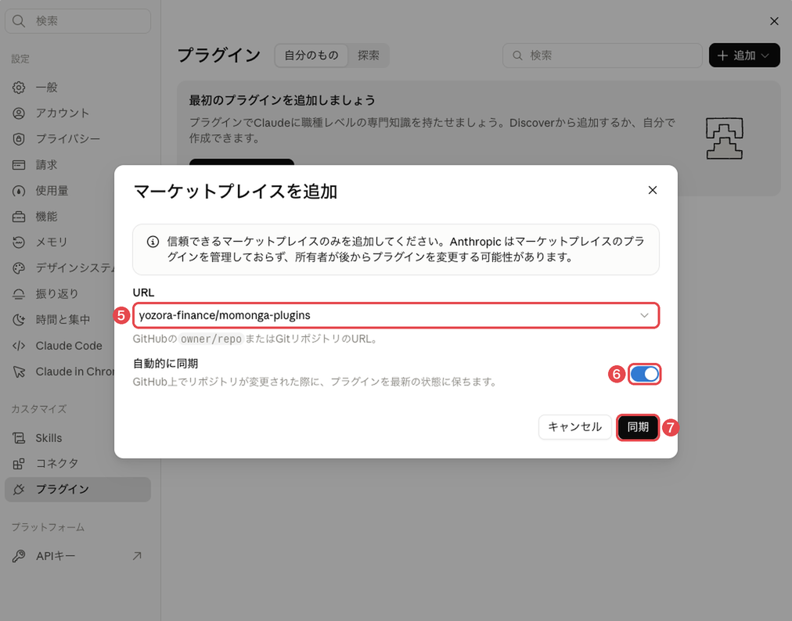
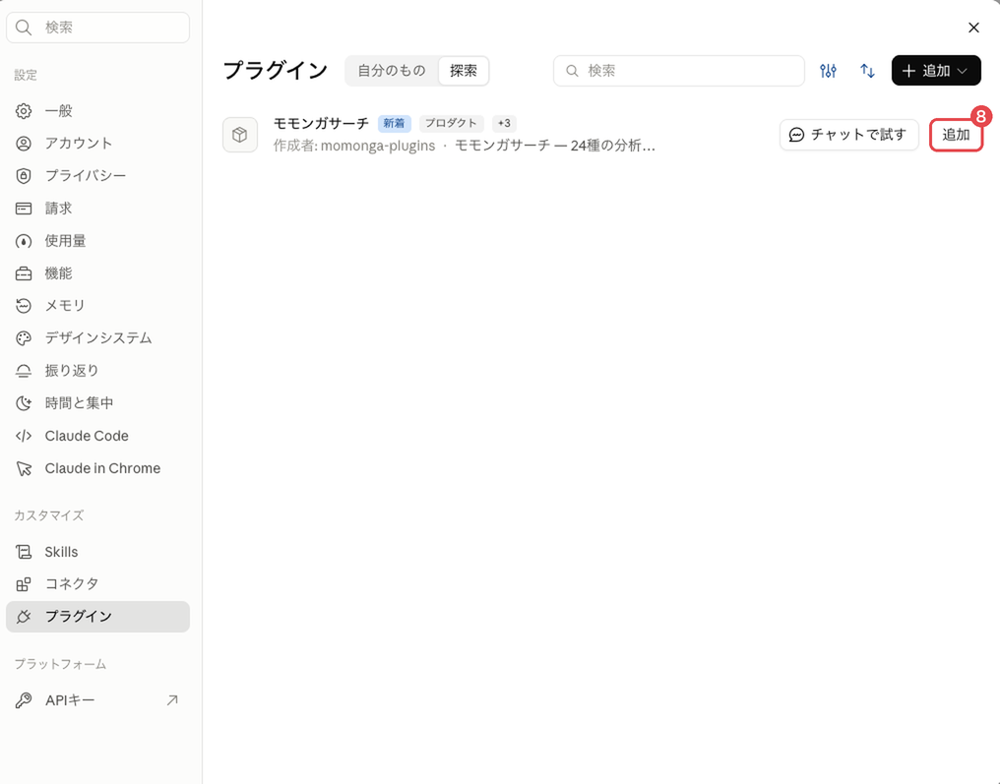
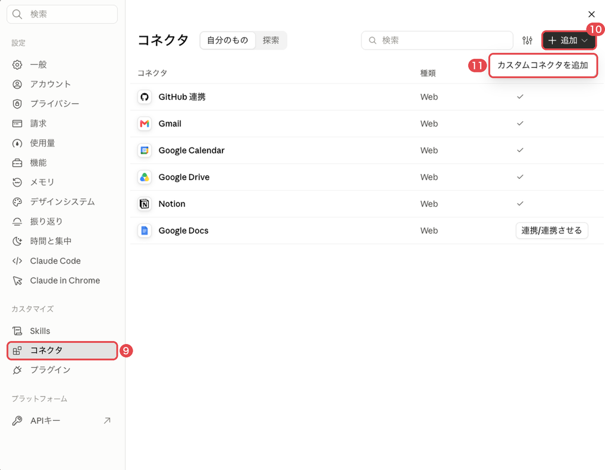
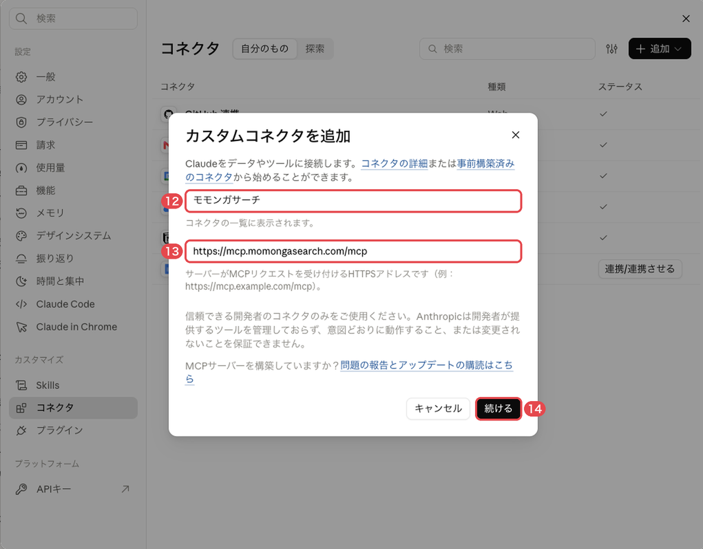
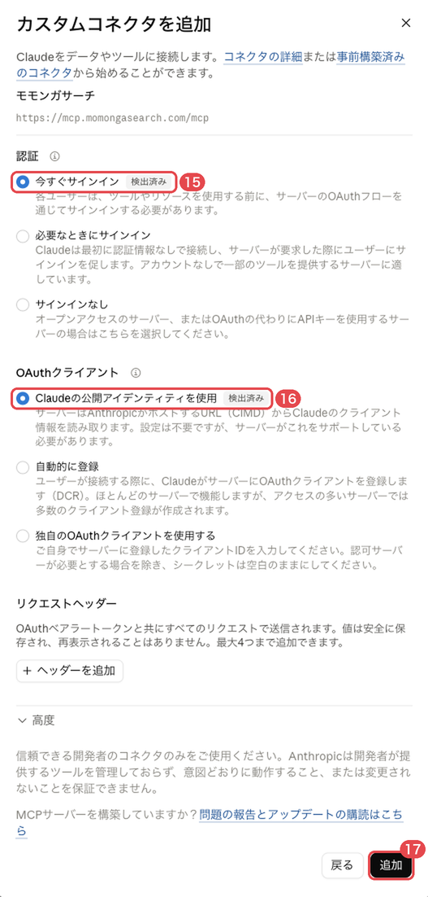
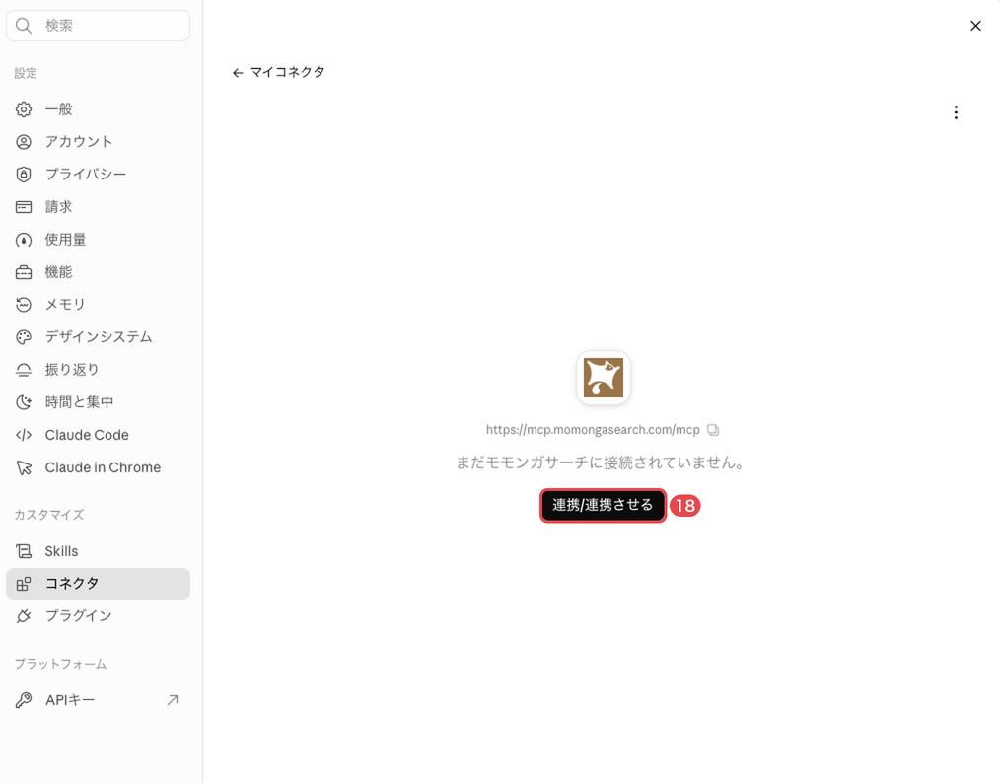
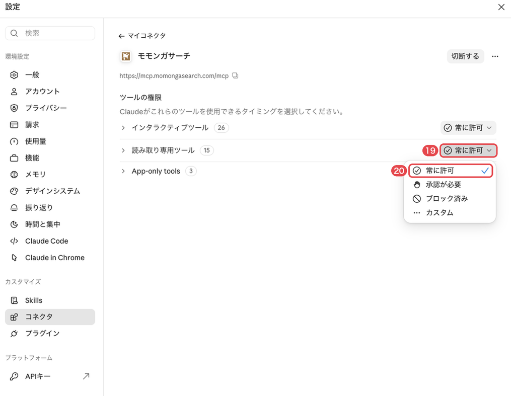

# Claudeでの導入手順

[トップ](../README.md)

Claudeの左上には2つのボタンがあり、画面を切り替えます。この手順では、吹き出しのボタンで開く画面を「Chat」、`</>` のボタンで開く画面を「Code」と呼びます。吹き出しのボタンは、マウスを重ねると「Claude」と表示されます。Codeはデスクトップアプリで使います。プラグインとコネクタはChatで設定すると、同じアカウント・組織のCodeでもそのまま使えます。



個人のアカウントと会社の組織では設定が分かれているため、左下の名前のメニューで利用する側に切り替えてから進めてください。

## 1. プラグインを追加する

[claude.ai](https://claude.ai/) またはデスクトップアプリのChatで、左下の名前のメニューから「設定」を開きます。画面は2026年10月時点のものです。

1. 左の列の「カスタマイズ」の下にある「プラグイン」を選び、右上の「＋追加」→「マーケットプレイスを追加」を押します（画像の①〜③）。

   

2. 「リポジトリから追加」を選びます（④）。

   

3. URLに `yozora-finance/momonga-plugins` を入力します（⑤）。`https://github.com/yozora-finance/momonga-plugins` でも構いません。「自動的に同期」がオンになっていることを確かめて（⑥）、「同期」を押します（⑦）。新しい版が自動で届くようになります。

   

4. 同期が終わると「探索」に「モモンガサーチ」が表示されます。その行の「追加」を押します（⑧）。

   

## 2. モモンガサーチに接続する

「設定」の左の列で「コネクタ」を開きます（⑨）。

- 会社の組織で使う場合：一覧にある「モモンガサーチ」を開き、「連携させる」（画面の表記は「連携/連携させる」）を押します（下の⑱と同じ画面です）。一覧にない場合は、管理者に登録を依頼してください。
- 個人のアカウントで使う場合：次の手順で追加します。

1. 右上の「＋追加」→「カスタムコネクタを追加」を押します（⑩・⑪）。

   

2. 名前に「モモンガサーチ」（⑫）、URLに `https://mcp.momongasearch.com/mcp`（⑬）を入力し、「続ける」を押します（⑭）。

   

3. 次の画面で、「認証」が「今すぐサインイン」（⑮）、「OAuthクライアント」が「Claudeの公開アイデンティティを使用」（⑯）になっていることを確かめて、「追加」を押します（⑰）。どちらも「検出済み」と表示され、最初から選ばれています。「このURLのコネクタはすでに組織内に存在します」と表示された場合は追加せず、一覧にある「モモンガサーチ」を開きます。

   

4. 「まだモモンガサーチに接続されていません。」と表示されたら、「連携させる」（画面の表記は「連携/連携させる」）を押します（⑱）。

   

ブラウザで `auth.momongasearch.com` のログイン画面が開きます。招待されたメールアドレスのGoogleアカウントでログインし、「接続するアプリ」と「利用する法人」を確認して許可します。利用する法人が表示されない場合は、「別のアカウントでログイン」を選び、招待されたアカウントに切り替えてください。Claudeに戻り、コネクタの一覧で「モモンガサーチ」のステータスに✓が付けば接続完了です。一度許可したあとは、ログイン画面を省略してそのままClaudeへ戻ることがあります。

接続できたら、同じコネクタの画面の「ツールの権限」で、「承認が必要」と表示されているものをすべて「常に許可」に変えます（⑲・⑳）。モモンガサーチのツールは資料を読むだけで、書き込みや削除は行いません。「承認が必要」のままだと、1つのコマンドの途中で何度も確認が表示されます。グループの名前や数は画像と違うことがあります。



## 3. 動作を確かめる

Chatで新しいチャットを開き、次の文を送信します。ツールの使用の確認が表示された場合は許可します。出典付きのファクトシートが表示されれば導入完了です。

```text
モモンガサーチのファクトシートでトヨタ自動車（7203）を調べて
```

## Codeで使う

Chatと同じアカウント・組織でCodeを開き、作業フォルダを選んで新しいセッションを開始します。入力欄に `/` を入力して「ファクトシート」を選び、「トヨタ自動車（7203）」と続けて送信します。

コマンドが候補に表示されない場合は、Codeの「カスタマイズ」→「プラグイン」で「モモンガサーチ」を一度オフにしてからオンに戻し、新しいセッションを開き直します。コネクタとログイン状態はChatの設定がそのまま引き継がれます。

[コマンド一覧](commands.md) ／ [困ったとき](troubleshooting.md)
