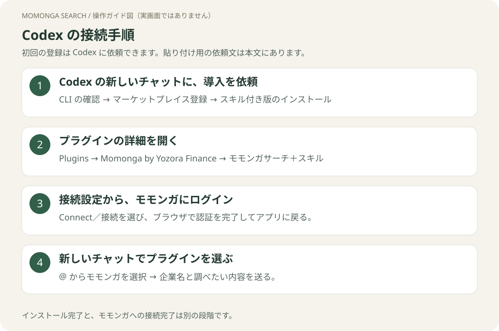

# Codex で接続する

[ガイドのトップ](README.md)



## 1. Codex に導入を頼む

Codex のデスクトップ画面を開き、新しいチャットに次を貼り付けます。

```text
モモンガサーチ＋スキルをこのPCのCodexで使えるようにしてください。
1. codex --version と git --version でCLIを確認してください。
   未導入ならOSに合う公式手順で導入を案内してください。
2. 次を実行してください。
   codex plugin marketplace add yozora-finance/momonga-plugins --ref main
   codex plugin add momonga-search-skills@momonga
3. インストール結果を確認し、アプリのプラグイン接続設定から
   モモンガへのOAuthログインを始める場所を案内してください。
   ログインと権限の許可は自分で行います。
4. 最後に、新しいチャットでモモンガを選ぶ方法と検索の試し方を教えてください。
```

自分で設定する場合は、[公式CLIの導入ガイド](https://learn.chatgpt.com/docs/codex/cli)に従って CLI を用意し、ターミナル（Windows は PowerShell）で次を実行します。

```sh
codex plugin marketplace add yozora-finance/momonga-plugins --ref main
codex plugin add momonga-search-skills@momonga
```

検索のみの通常版を選ぶ場合は、2行目を `codex plugin add momonga-search@momonga` に置き換えます。

## 2. プラグインを開く

**Plugins／プラグイン → ディレクトリ**で **Momonga by Yozora Finance** を探します。
**モモンガサーチ＋スキル**がインストール済みで有効か確認してください。
カタログが表示されなければ、アプリを終了して起動し直します。

## 3. モモンガへの接続を完了する

プラグイン詳細の接続設定から **Connect／接続**を選び、ブラウザでモモンガのアカウントにログインします。
要求された権限を確認して許可し、元のアプリに戻ります。


[認証の詳しい説明と完了条件](authentication.md)を確認してください。
CLI のインストールが成功しても、OAuth 認証まで済んだとは限りません。

## 4. 新しいチャットで使う

入力欄で **`@`** を入力してモモンガのプラグイン／Skill を選び、次を送ります。

```text
モモンガサーチを使って、トヨタ自動車（7203）の直近決算を出典付きで調べて。
```

ツール使用の確認が出たら内容を確認して許可します。モモンガのツールが動き、出典付きの結果が返ることを確認してください。
分析コマンドを使う場合も、候補から `factsheet` などの Skill を選択して企業名を続けます。

CLI では `/plugins` でプラグインを確認し、導入後は新しいセッションを開始します。
ローカルCLIのOAuthコールバックはデスクトップのクラウド接続とは異なるため、このガイドでは**デスクトップの接続設定で認証する手順**を案内しています。CLIだけでの認証完了は未確認です。

## 更新する

```sh
codex plugin marketplace upgrade momonga
```

その後、プラグイン画面に更新が表示される場合は適用し、新しいチャットを開きます。

[コマンド一覧](commands.md) · [困ったとき](troubleshooting.md)
