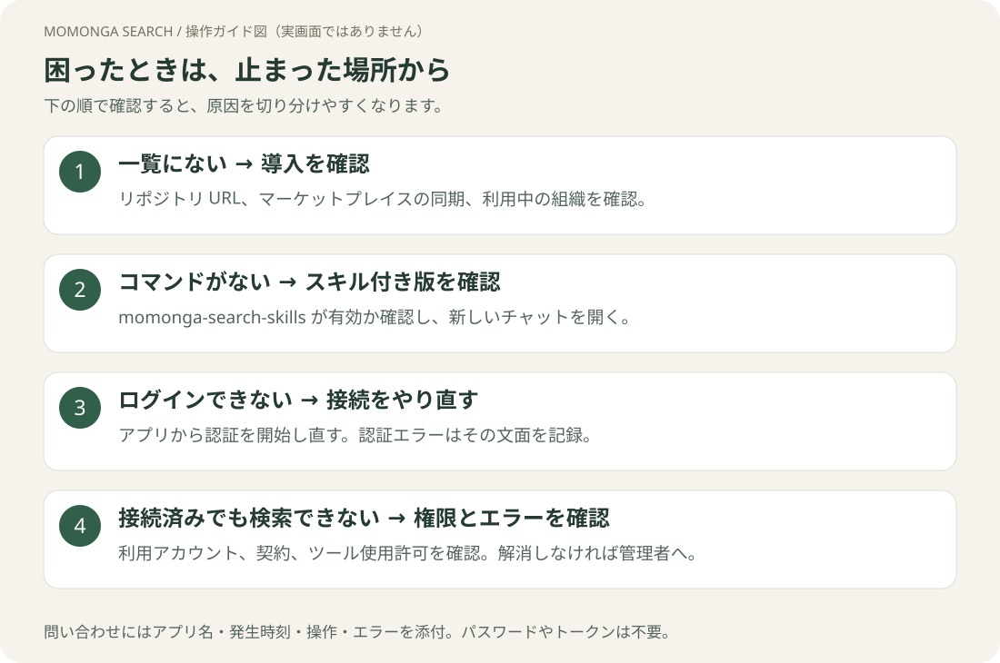

# トラブルシューティング

[ガイドのトップ](README.md)



| 症状 | 確認すること・対処 |
|---|---|
| マーケットプレイスを追加できない | URL を `https://github.com/yozora-finance/momonga-plugins` にします。組織の登録元制限や GitHub アクセスの承認待ちを確認します。 |
| プラグイン一覧にモモンガが出ない | 同期が完了したか、正しい組織・マーケットプレイスを見ているか確認。Desktop は再起動し、登録した PC・環境で開きます。 |
| `codex: command not found` | [公式CLI手順](https://learn.chatgpt.com/docs/codex/cli)で導入し、ターミナルを開き直して `codex --version` を確認します。 |
| `plugin` コマンドが認識されない | Codex CLI を公式手順で更新し、`codex plugin --help` を確認します。 |
| `git` が見つからない | Git を導入し、ターミナルを開き直して `git --version` を確認します。Codex への導入依頼文も利用できます。 |
| Claude で `/` を入力しても分析コマンドが出ない | **モモンガサーチ＋スキル**が有効か確認。通常版には24種のコマンドはありません。新しいチャットを開きます。 |
| Codex / ChatGPT で `/factsheet` が動かない | `@` からプラグインまたは Skill を選びます。Claude の `/` と選択方法が異なります。 |
| Skills が25個と表示される | 正常です。共通検索 Skill 1個＋分析コマンド24個です。 |
| AI がモモンガを使わずに回答する | プラグイン／Skill を明示的に選択し、「モモンガサーチを使って」と依頼。ツール実行の有無を確認します。 |
| インストールしたのに認証を求められる | インストールとモモンガへの接続は別です。[認証手順](authentication.md)を完了します。 |
| 「接続／連携」が押せない | Web は再読み込み、Desktop は終了して再起動。その後プラグインの接続設定を開き直します。 |
| 認証画面が開かない | ブラウザのポップアップ制限を確認し、アプリ側から接続を開始し直します。 |
| 認証後に元のアプリに戻らない | ブラウザの完了表示を確認して元のアプリへ戻ります。未接続ならアプリから認証を開始し直します。以前の認証URLを使い回さないでください。 |
| `redirect_uri` / `invalid_client` エラー | プラグインを更新して再試行。カスタム MCP なら client ID と戻り先を[ChatGPTの設定表](chatgpt.md#web-のカスタム-mcp-接続を使う場合)で確認。ローカルCLIにクラウド用設定を流用しないでください。 |
| `401`・認証期限切れ | 接続設定から再ログインします。解消しない場合はエラー文と時刻を管理者に伝えます。 |
| `403`・利用権限がない | モモンガにログインしたアカウントと本人・法人の利用権限を確認します。再インストールだけでは権限は付与されません。 |
| 接続済みだがツールが実行されない | 新しいチャットで選び直し、ツール使用がブロックされていないか確認。使用確認が表示された場合は内容を確認して応答します。 |
| `429`・利用制限 | 表示された待機時間や利用制限に従います。短時間の連続再試行を避け、続く場合は管理者へ確認します。 |
| 時間がかかる・途中で止まる | 分析は複数資料を読むため数分かかることがあります。失敗表示がある場合は文面を控え、企業数・期間を絞って再試行します。 |
| 出典がない・検索が0件 | 会社名に証券コードを添え、対象期間・資料種別を確認します。0件は接続障害とは限りません。 |
| ChatGPT Web にプラグインが見つからない | GitHub公開だけでは公開ディレクトリには載りません。MCP同梱版の組織インポートはDesktop onlyです。[ChatGPTの導入経路](chatgpt.md)を確認します。 |
| Web の MCP 接続に分析コマンドがない | MCP 接続だけでは Skills は入りません。スキル付きプラグインを導入できるデスクトップ環境を使います。 |
| 更新が反映されない | マーケットプレイスを同期してからプラグインの更新を確認します。適用後は新しいチャットを開きます。 |

## 解決しないときに伝えること

次をコピーして、社内管理者またはモモンガの担当者へ送ってください。

```text
使用アプリ（Claude Web / Claude Desktop / Codex / ChatGPT）：
OS・アプリのバージョン：
プラグイン名・バージョン：
発生日時（タイムゾーンも）：
止まった手順：
表示されたエラー：
試した対処：
```

画像を添付すると伝わりやすくなります。パスワード、APIキー、アクセストークン、認証中のURLは送らないでください。
